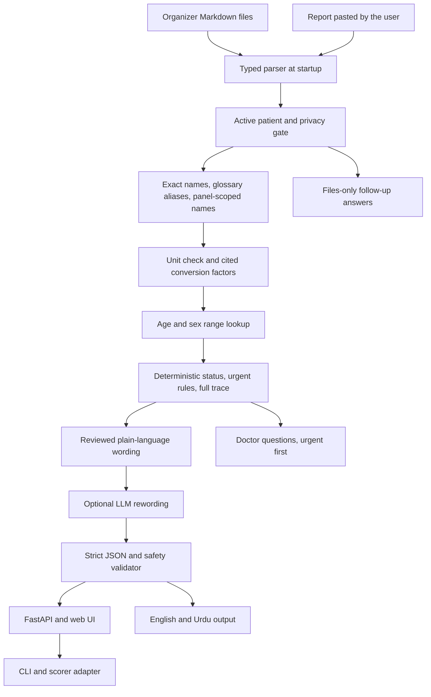

# Medical Lab Report Explainer

Challenge B, CityLab Diagnostics, Tech Fusion '26. This app reads a patient's lab report, compares every result with the ranges, aliases, and urgent thresholds supplied by the organizer, explains each one in simple words in English or Urdu, and writes questions for the doctor. It does not diagnose.

The organizer's original `README.md` and every file in `lab_reports/` are kept untouched. This project guide lives in `PROJECT_README.md` so that source history and content survive intact.

## What it does, against the four required behaviours

| Required behaviour | Where it happens | Evidence to look at |
|---|---|---|
| Read the results and mark each normal / low / high / urgent, watching units | `core/classify.py`, `core/units.py` | `python eval.py` prints all 14 reports with the matched analyte, any conversion working, the status and the rule |
| Explain in simple words what each test measures and what low or high can mean | `core/plain_language.py`, polished by `llm/` | Any result row in the UI shows "What this test measures" and "What this result can mean" |
| Handle messy reports: aliases, units, boundaries, missing demographics, unclassifiable tests | `core/names.py`, `core/ingest.py`, `core/service.py` | P002, P005, P008, P003, P012, P006 in the table below |
| Protect privacy and give 3-5 doctor questions with urgent warnings | `core/service.py`, `core/plain_language.py` | Ask about another patient while a report is active; see the urgent banner on P004 |

## Architecture



The core loads typed Pydantic records from `lab_reports/`. It reads report content only before the compliance appendix, matches test names by normalization, glossary aliases, and the qualifier the range sheets themselves use, converts units only with an explicit factor that it then shows, and selects ranges by age and sex. Urgent thresholds take precedence over low/high. Every classified result carries its range row and rule trace.

The LLM is optional and never sees raw report text. It receives the deterministic results plus the reviewed wording and may only restate them more simply. It cannot set a status, select a range, convert a unit, or raise an urgent warning. Invalid JSON, changed fields, restated numbers, diagnosis phrasing, or a wrong question count are rejected; the layer retries once, then falls back to the reviewed wording. **Classification is fully deterministic and works with no provider key at all.**

## Verification

`python eval.py` prints one hand-checkable row per test across all 14 sample reports. Every row is correct against the organizer files, including each case the corpus was built to trap:

| Report | What it tests | Result |
|---|---|---|
| P002 | Alias plus boundary: SGPT at exactly the female upper limit | matched to ALT, female range, `normal` by the stated edge-case rule |
| P005 | Unit conversion: Fasting Blood Sugar in mmol/L | converted `6.0 mmol/L x 18.0182 = 108.11 mg/dL`, `high`, working shown |
| P008 | Short names in a urine panel: `pH Level`, `Protein` | matched to Urine pH and Urine Protein, both `normal` |
| P003 | Corrupted age and sex | every result `needs_clarification`; nothing guessed from the name |
| P012 | Missing sex only | `needs_clarification`; the two AST ranges differ by sex |
| P004 | Urgent plus a separate low result | Hemoglobin `urgent` with the banner, Platelet Count `low` |
| P006 | Analyte with no range anywhere in the files | `cannot_classify` with the reason given |
| P010 | Cholesterol at exactly the upper limit | `normal` |
| P001, P007, P009, P011, P013, P014 | Plain, table, arrow and bullet layouts; aliases Hb, WBC, PLT, FBS, SGOT | all classified against the right range |

`pytest -q` runs 42 tests covering parsing, name matching, units, boundaries, urgent rules, privacy, the LLM validator, the plain-language guard, and the HTTP API.

## Two deliberate departures from "files only", and why

Everything clinical comes from the organizer files, with two documented exceptions. Both are visible in the output rather than hidden.

**1. Unit conversion factors.** The corpus contains no factor table, but the problem statement requires "convert before comparing, and show the conversion", the corpus README lists "different units (e.g., mmol/L instead of mg/dL)" as a checkpoint, and the only report that exercises it is named `..._Sugar_UnitConv.md`. Refusing to convert left that result unclassified. `core/config.py` therefore holds a short list of published analytical constants, each stating its derivation (glucose molar mass 180.156 g/mol gives 18.0182 mg/dL per mmol/L). Any factor parsed from an organizer file takes precedence, and every converted result shows the factor, the arithmetic, and the label "documented standard constant (not from the organizer files)".

**2. Plain-language test descriptions.** The glossary maps aliases; it does not say what a test measures. The problem statement requires exactly that, at a class-8 reading level. `core/plain_language.py` holds reviewed wording for the eleven analytes that appear in the corpus, in English and Urdu, kept apart from the classification code: it cannot set a status, choose a range, or convert a unit. The output labels it as the project team's wording, and a test asserts that no sentence in it can trip the diagnosis-wording guard.

## Known failure cases

- **Boundary assumption outside hematology.** Only the hematology sheet states that a value exactly on a limit is normal. The biochemistry and thyroid/urine sheets are silent, so the same convention is applied to them through one `ENDPOINTS_INCLUSIVE` setting. The trace and the explanation both say so on every affected result.
- **Urgent limits: the file contradicts itself.** The table says "Less than 7.0", but the same file's prose says a warning is needed when a result "hit[s] or pass[es]" a threshold. The status uses the strict comparison the table states, so Hemoglobin of exactly 7.0 is `low`, not `urgent`; the warning still fires, and the explanation states the conflict. If the official scorer reads that sentence as inclusive, this one boundary case will disagree.
- **Qualitative results other than the listed value.** The files give Urine Protein a single reference value, "Negative". A result of "Trace" or "Positive" matches no listed value and no rule covers it, so it is reported `cannot_classify` rather than being called abnormal. An unseen test set may expect "high" here.
- **Conversion covers only the units in and around this corpus.** mmol/L for glucose and cholesterol, g/L to g/dL, the 10^9/L and 10^3/uL family to cells/mcL, and uIU/mL to mIU/L. An unseen unit outside that set is reported `cannot_classify` instead of being guessed.
- **Panel scoping needs the report to name its panel.** `pH Level` resolves to Urine pH because the report identifies a urine panel in its file name or a heading. A urine report that names neither leaves both short names unclassified, which is the safe failure: `Protein` on its own in a blood panel must not become Urine Protein.
- **Ages outside every listed band.** The sheets cover 18-100 years. A younger or older patient produces `cannot_classify` for every test rather than borrowing the nearest band.
- **Missing or corrupted demographics block classification entirely.** P003 and P012 return `needs_clarification` for every result. Nothing is inferred from a patient's name, which is also why "Bob Jones" is correctly treated as female in P002.
- **Analytes with no range are never explained away.** Serum Ferritin stays `cannot_classify`; the plain-language module also declines to describe a test the files do not list.
- **Report layout drift.** The parser handles the bullet, table, plain-label and arrow layouts in the corpus, plus pasted text in the same shapes. A materially different unseen layout may yield no results; malformed rows are logged and skipped rather than guessed.
- **Unknown scorer contract.** The organizers have not published the automated scorer's request or response schema. `adapters/scorer.py` is isolated from the core so only that file needs reshaping when they do.
- **LLM connectivity is unverified at the provider.** The fallback path, validator, retry, timeout, rate-limit and circuit-breaker logic are all covered by tests, but no provider key was available during local verification, so live rate limits and model-specific JSON compliance still need a keyed smoke test. Every failure falls back to the reviewed wording, so a dead provider degrades wording quality and nothing else.
- **Text after an appendix heading is ignored**, even if a future report puts real results there.

## Run locally

```powershell
python -m venv .venv
.\.venv\Scripts\Activate.ps1
pip install -r requirements.txt
python -m uvicorn app.main:app --reload
```

Open `http://127.0.0.1:8000`. The interactive API reference is at `/docs`.

```powershell
python -m app.cli analyze P001
python -m app.cli analyze P004 --language ur
python -m app.cli ask P001 "What does Hemoglobin measure?"
python eval.py
pytest -q
```

## Run with Docker

```powershell
docker compose up --build
```

Open `http://localhost:8000`. Docker needs no cloud account: with no provider key the app uses the reviewed wording templates and every classification still runs. To try an optional free-tier provider, copy `.env.example` to `.env` and add your own key. `.env` is ignored by Git; never commit a real key.

## Deploy to Vercel

The repository carries a serverless entry point at `api/index.py` that exposes the same
ASGI app the container runs, and `vercel.json` rewrites every path to it and bundles the
reference files the app reads.

```powershell
npm i -g vercel
vercel login
vercel --prod
```

The project needs no environment variables to run: with no provider key the reviewed
wording templates are used and every classification still happens. To enable the
optional wording layer, add `GEMINI_API_KEY` (or `GROQ_API_KEY` / `OPENROUTER_API_KEY`)
under Project Settings, Environment Variables, and redeploy.

Vercel builds this project on Python 3.12. If a build ever selects an older runtime,
set the Python version in Project Settings; the Pydantic models use `X | None`
annotations that need 3.10 or newer.

## LLM use and tool rules

The rulebook allows free-tier models only. Provider order is configurable in `.env`: Gemini (the tokens the organizers provide on the day), then Groq, then a free OpenRouter model. No model is trained or fine-tuned here, and no pre-built template or earlier project is used. The HTTP client runs at temperature zero with request timeouts, bounded retries with jitter, honours `Retry-After`, opens a short-lived circuit breaker after repeated failures, and caches successful responses by prompt hash, so a free-tier rate limit degrades gracefully instead of failing the request.

## API

| Method | Route | Request | Purpose |
|---|---|---|---|
| `GET` | `/health` | none | Health and loaded report count |
| `GET` | `/patients` | none | Patient IDs only, for the active-report selector |
| `POST` | `/analyze` | `{"patient_id":"P001","language":"en"}` | Deterministic analysis plus validated wording |
| `POST` | `/analyze-text` | `{"report_text":"...","language":"en"}` | The same analysis for a report pasted by the user |
| `POST` | `/ask` | `{"patient_id":"P001","question":"..."}` | Files-only answer about the active patient, with citations |

Core functions are `core.analyze_patient`, `core.analyze_report_text`, and `core.answer_question`.

`/patients` returns IDs only. Names and report contents are returned only after a specific patient ID is selected, and a question naming any other patient's ID or name is refused with a citation to `1_lab_safety_rules.md`.

## Demo route (about 90 seconds)

1. P002: SGPT matched to ALT, the female range, the exact-limit rule, and the source trace.
2. P005: the mmol/L conversion with its factor and arithmetic shown, classified `high`.
3. P004: the urgent banner, the separate low platelet result, and the doctor questions led by the urgent one.
4. P003: a request for the missing age and sex, with no classification attempted.
5. P008: `pH Level` and `Protein` resolved through the urine panel.
6. Switch to Urdu, then ask about another patient while P001 is active to show the refusal and its citation.
7. Paste a report that is not in the corpus and explain it.
8. Close on `docker compose up --build` as the one-command run path and the known failure cases above.
