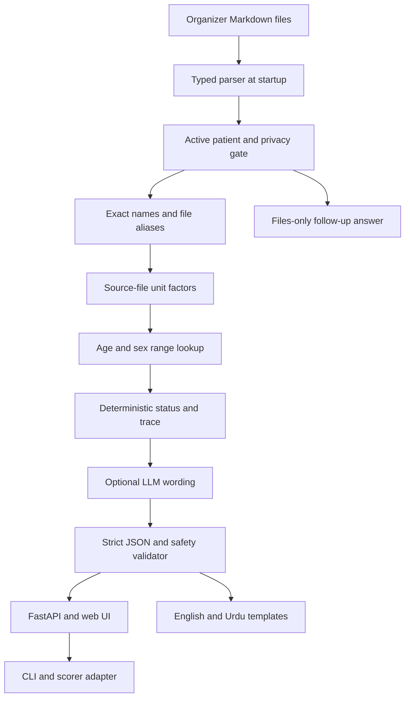

# Medical Lab Report Explainer

Challenge B, CityLab Diagnostics, Tech Fusion '26. This app compares one selected report with the ranges, aliases, urgent thresholds, and safety rules supplied by the organizer. It explains those comparisons in English or Urdu. It does not diagnose.

The organizer's original `README.md` and every file in `lab_reports/` are kept untouched. This project guide is in `PROJECT_README.md` to preserve that source history and content.

## Architecture



The core loads typed Pydantic records from `lab_reports/`. It reads report content only before the compliance appendix, matches test names by case/whitespace/punctuation normalization and exact glossary aliases, uses only explicit conversion factors found in source files, and selects ranges by age and sex. Urgent thresholds are strict and take precedence over low/high classifications. Every classified test includes its range row and rule trace.

The LLM is optional and only receives the deterministic results plus glossary mappings. It can supply short wording and doctor questions; it cannot set a status, select a range, convert a unit, or generate an urgent warning. Invalid JSON, changed output fields, numeric restatements, diagnosis phrasing, or an invalid question count are rejected. The wording layer retries once, then uses fixed English or Urdu templates. Classification works without provider keys.

## Run locally

```powershell
python -m venv .venv
.\.venv\Scripts\Activate.ps1
pip install -r requirements.txt
python -m uvicorn app.main:app --reload
```

Open `http://127.0.0.1:8000`. The interactive API reference is at `/docs`.

To run the CLI:

```powershell
python -m app.cli analyze P001
python -m app.cli analyze P004 --language ur
python -m app.cli ask P001 "What is my Hemoglobin result?"
python eval.py
pytest -q
```

`eval.py` prints a hand-checkable row for every test in all 14 sample reports.

## Run with Docker

```powershell
docker compose up --build
```

Open `http://localhost:8000`. Docker works without a cloud account; the app uses deterministic wording templates when no provider key is configured. To try an optional free-tier provider, copy `.env.example` to `.env` and add your own key. `.env` is ignored by Git. Never commit a real key.

Provider defaults are configurable in `.env`: Gemini, Groq, then OpenRouter. The HTTP client uses temperature zero, request timeouts, bounded retries with jitter, honors `Retry-After`, opens a short-lived circuit breaker after repeated failures, and caches successful responses by prompt hash. Provider availability and free-tier model names can change; override the model variables when needed.

## API

| Method | Route | Request | Purpose |
|---|---|---|---|
| `GET` | `/health` | none | Basic health and loaded report count |
| `GET` | `/patients` | none | Patient IDs only, for the active-report selector |
| `POST` | `/analyze` | `{"patient_id":"P001","language":"en"}` | Deterministic analysis plus validated wording |
| `POST` | `/ask` | `{"patient_id":"P001","question":"What is my Hemoglobin result?"}` | Files-only active-patient answer with citations |

Core functions are `core.analyze_patient(patient_id)` and `core.answer_question(patient_id, question)`. `adapters/scorer.py` is isolated from those functions because the official scorer request and response schema has not been provided. It currently accepts a JSON object with `patient_id`, and `question` for the ask adapter; reshape only that module when organizers publish the contract.

The app limits the patient listing to IDs. Names and report contents are returned only after a specific patient ID is selected. A request mentioning a different patient's ID or name is refused with a citation to `1_lab_safety_rules.md`.

## Design decisions

- Deterministic classification always runs before explanation. Provider failures never change the clinical status.
- Unsupported names, ranges, and units are reported as `cannot_classify`; no outside ranges or conversion constants are added.
- Missing, corrupted, or invalid age/sex produces `needs_clarification` for every test in that report. Ages outside every supplied range produce `cannot_classify`.
- The hematology sheet says range endpoints are normal. For the other range sheets, the same convention is applied through `ENDPOINTS_INCLUSIVE` and the trace/explanation state this assumption.
- Report parsing is limited to the known bullet, table, plain-label, and arrow layouts. Free-form text and appendix text are not instructions.
- The supplied glossary contains aliases, not definitions of what each test measures. Explanations therefore describe only the comparison supported by the file rows.

## Known Failure Cases

- **Boundary assumption outside hematology:** Biochemistry and thyroid/urine sheets do not state endpoint inclusivity. The hematology rule is applied to those ranges by the single `ENDPOINTS_INCLUSIVE` setting. This is an explicit assumption, not source-sheet guidance.
- **No unit conversion factors:** The corpus contains no conversion factor table. Fasting Blood Sugar reported as `6.0 mmol/L` cannot be converted to the `mg/dL` range and remains `cannot_classify`.
- **P008 short names have no section context:** `pH Level` and `Protein` appear under the generic `SECTION III: ANALYTICAL RESULTS` heading. The file name contains “Urine,” but it is not used as a test alias or section heading. Both values remain `cannot_classify` until the source provides an explicit alias or clearly urine-scoped section.
- **Missing or corrupted demographics:** P003 has corrupted age and sex; P012 has no sex. Their results are not classified until the missing demographics are provided. No values are inferred from names.
- **Unknown analytes:** Serum Ferritin appears in P006 but has no matching range in the files, so it remains `cannot_classify`.
- **No test definitions:** The medical glossary maps names only. The app does not describe test physiology or claim what a high/low result means medically; that information is not in the supplied files.
- **Unknown scorer contract:** Organizers have not supplied the automated scorer's endpoint, request fields, or response schema. The isolated scorer adapter is provisional.
- **Report layout drift:** The parser handles the 14 supplied report layouts. A materially different unseen layout may be skipped or require a parser update; malformed rows are logged and skipped.
- **LLM limits:** No real provider key was available during local verification. Provider requests are covered by fallback behavior and client logic, but live provider connectivity, rate limits, and model-specific JSON compliance still need a keyed smoke test. Failed or rejected output falls back to templates.
- **Appendix placement:** Text after a report's appendix heading is excluded, even if a future report places real results there.

## Demo video script (about 60 seconds)

1. Select P002 and show SGPT matching ALT, the female range, the endpoint classification, and the source trace.
2. Select P004 and show the urgent banner and the separate low platelet result.
3. Select P003 and show the request for missing age and sex, without a classification.
4. Select P005 and show that mmol/L is not converted because the files contain no factor.
5. Switch to Urdu and show the wording fallback; ask a question naming P002 while P001 is active to demonstrate the privacy refusal and citation.
6. End by showing Docker Compose as the one-command local run path and the `KNOWN FAILURE CASES` section.

